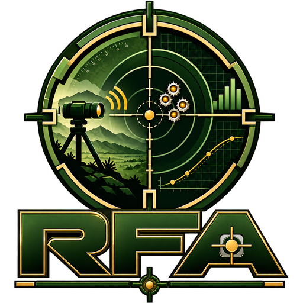

<p align="center"></p>

# Remote Firing Analyzer 2.7

Rifle zeroing from a photo, a camera or a CCTV lane. The app finds the 32 in outer ring
by itself, uses it to calibrate the picture, detects every bullet hole, works out the
group, MPI and BD-08 sight correction, and keeps each firer's record on the computer.

Everything runs in the browser: no server and no internet. The two small neural networks
that check bullet holes are built into the app (no downloads). Build it once and copy the
`out/` folder to a range laptop, Firebase Hosting or any web server.

---

## Quick start

```bash
npm install        # or: pnpm install
npm run dev        # http://localhost:3000
npm test           # 21 unit, vision and replay tests
npm run build      # static site in out/
```

Deploy to the existing Firebase project:

```bash
npm run build
firebase deploy --only hosting
```

Cameras need a secure page: `https://…` or `http://localhost`. A plain `http://` address
on the network will block the camera (CCTV streams still work).

---

## Using it

1. **Picture.** Choose a photo (or drop one on the picture area), start a USB/laptop
   camera, or start a CCTV lane.
2. **Ring calibration.** The outer 32 in ring is found automatically. Pixels are
   converted to inches from it, with separate horizontal and vertical scales, so a camera
   looking slightly up at the target still measures correctly.
3. **Hole detection.** Holes are found on white paper, inside the black aiming mark, on
   printed ring lines, and where two holes touch (those are marked orange to check).
4. **Review.** Drag marks, add missed holes, delete false ones, move the aiming point or
   the ring. Everything recalculates instantly.
5. **Record.** Choose the firer, add the weapon number and save. Print gives an A4
   record with signature lines.

### Sessions (several groups by one firer)

1. Fire group 1, analyse it, choose the firer and press **Save group 1**.
2. Press **Next group**. Group 1 stays on screen as see-through coloured marks.
3. Fire group 2 and analyse a new photo (or keep the live view running). Holes of
   earlier groups are recognised and **not counted again**.
4. Every group is saved in the firer's record with its session and group number.
   Use the eye buttons to hide a group, the layers button to hide all, and
   **End session** when the firer is finished.

### Calibration

- **Automatic:** the outer 32 in ring (blue) is found by itself, including camera
  tilt (perspective) and which way is up (from the printed crosshair).
- **Adjust ring (R):** drag the handles onto the outer ring if it is off (this switches
  to a plain ellipse without the perspective model).
- **Two points (M):** click point A and point B a known distance apart (for example
  two ring lines on the same axis), type the distance in inches, cm or mm, then click
  the aiming point.

### Result sheet (PDF)

**PDF** downloads an A4 sheet: header with the RFA logo and the Bangladesh Army crest, status banner, firer and result tables, BD-08
correction, the whole target, a close-up of the group (earlier groups see-through),
the session table, coaching notes and signature lines. Records → a group → **PDF**
gives the same sheet later.

### Live view (camera or CCTV)

- The target is searched every frame until the ring holds steady, then the calibration
  is **locked** (with camera tilt corrected).
- **Hold fire** while the status shows *Reading target* (about 2 seconds). The app learns
  the target as it is: printed lines, wrinkles, folds, the board edge and any old holes.
  None of these can ever be counted.
- From then on every frame is **aligned** to that learned picture (camera shake and the
  target swaying in the wind are cancelled) and compared with it. A hole is counted only
  when it is **new**, **hole-sized**, accepted by the before/after neural network and
  **still there over several frames**. Hits are numbered in firing order.
- If too much of the picture changes at once (camera bumped, sudden light, someone
  walking past) the status shows *Picture moving* and nothing is counted from those
  frames. If it lasts, the target is read again; hits already counted are kept.
- A change that disappears again (bird, insect, passing shadow) is removed by itself.
- When all 5 hits are found and nothing changes for 2.5 s, the frame is frozen for
  review automatically (switch this off in Settings). **Capture** does it by hand.
- **Next group** keeps the holes already on the target and counts only the next group.
  **Find ring** re-locks if the camera was moved; this also happens by itself.

Start the live view **before** firing. To analyse a target that already has holes,
press Capture: with no new hits counted, the frame is analysed like a photo.

### Shot group analysis (OWC précis)

The Group analysis card follows the OWC précis, Table 12-1 (para 1217), with the reasons from
paras 1417 and 1419. It names the pattern of the group, the firer's error and the remedy, in the
précis wording. **Précis chart** opens the full table with a small sketch of each pattern, and
the pattern of the current group is picked out.

| Ser | Pattern of group | Error | Remedy |
|---|---|---|---|
| 1 | Long vertical | Wrong sight alignment (vertical error), improper breathing | Explain the mistake; dry aiming practice and breathing control exercise |
| 2 | Long horizontal | Wrong sight alignment (lateral error), left hand moving sideways | Explain the mistake; dry aiming practice |
| 3 | Short vertical | Wrong placement of aiming point | As Ser 2 |
| 4 | Short horizontal | Wrong placement of aiming point | As Ser 2 |
| 5 | Low right | Improper trigger control, or left elbow slipping out | Tin disc exercise |
| 6 | Bifocal | Critical focus: once on the foresight, once on the point of aim | Blank target exercise |
| 7 | At 7 o'clock | Buck | Ball and dummy round exercise |
| 8 | At 4 o'clock | Jerk | Tin disc exercise |
| 9 | At 11 o'clock | Flinch | Cotton in the ears and tin disc exercise |
| 10 | Scattered | All possible mistakes | Re-examine all the factors of a steady hold |

How the app decides (all in inches on the target, `src/core/diagnostics.ts`, `precis.ts`):

1. **Good group** = grouping within the good-group limit (5 in, *Settings > Zeroing rules >
   Good group up to*) **and** the weapon zeroed (MPI within the 5 cm zero tolerance). The card
   says *No error / None needed*.
   A **tight group off the aiming point** is judged by where it sits, as the précis does:
   3:30–4:30 a 4 o'clock group (jerk), 4:30–5:30 low right (trigger control / left elbow),
   6:30–8:30 a 7 o'clock group (buck), 10:00–12:00 an 11 o'clock group (flinch). The sectors are
   wide on purpose: a group low left of the aim is a 7 o'clock group even when it sits nearer 8.
   In any other direction (high, high right, right, straight low, left) the précis names no
   firer error, so the card says *Sights not zeroed / Apply the sight correction*.
2. **Over the limit, an error decision is made.** The shots are split into the firer's
   **main group** (the most shots, at least half, that sit together, up to 1.5 times the limit)
   and the shots that went **astray** (clearly apart: the gap is well over the spacing inside
   the main group). Where the strays went, seen from the main group, names the error:
   - above or below: **bifocal group** (Ser 6)
   - 4 o'clock: jerk (Ser 8); 4:30 to 5:30: low right (Ser 5); 7 o'clock: buck (Ser 7);
     11 o'clock: flinch (Ser 9)
   - out to one side: horizontal group (Ser 2 or 4)
   - at both ends of a line: vertical or horizontal group (Ser 1 to 4)
   - in different directions: scattered group (Ser 10)

   Judging from the main group, not the aiming point, keeps the answer right while the weapon
   is still being zeroed.
3. **No clear main group:** the shape decides: strung up and down is a vertical group, sideways
   a horizontal group (**long** when over 7 in, the First class limit, otherwise **short**);
   anything else is a scattered group.
- For a firer marked left-handed the clock is mirrored (4 to 8, 7 to 5, 11 to 1).
- Examples: four shots round the centre and one shot 8 in away high right make a 10 in group.
  That is not scattered: it is a **bifocal group** (shot 4 above the main group). A 4.6 in
  group sitting 10 in low left of the aim is not a good group: it is a **group at 7 o'clock**
  (buck).
- A wide, round group with no main group that sits off the aim at one of those clock
  positions is named by its position; otherwise it is scattered.
- The error and remedy are saved with the record and printed on the PDF.

### Keyboard (review)

| Key | Action |
|---|---|
| V | Move tool (drag marks, aiming point, picture) |
| A | Add hit |
| P | Set aiming point |
| R | Adjust ring |
| M | Two-point calibration |
| Delete / Backspace | Delete the selected mark |
| Right-click a mark | Delete it |
| Ctrl+Z | Undo |
| + / − / 0 | Zoom in, zoom out, fit |

Mouse wheel zooms at the pointer; on phones and tablets pinch to zoom.

---

## Rules (unchanged from version 1, editable in Settings)

| Rule | Default |
|---|---|
| Rounds per group | 5 |
| Largest group allowed | 10 in |
| Zero tolerance (MPI to aiming point) | 5 cm |
| BD-08 lateral | 32 cm per sight turn |
| BD-08 vertical | 24 cm per sight turn |
| Calibration ring | 32 in diameter |
| Marksman / First class / Standard | up to 4 / 7 / 10 in |

Result: **Zeroed** (MPI within tolerance), **Adjust sights**, **Washout** (wrong number of
rounds or group over the limit). While rounds are still missing the screen shows
*Waiting for rounds*; a record saved in that state is stored as a washout.

The correction says which way the **MPI must move** to reach the aiming point, in cm and
in sight turns. Apply it with your normal BD-08 sight drill.

---

## Records

Firers and their groups are stored in the browser's IndexedDB on this computer (and in the local database file when it is running, see Local database):
personal number, rank, name, unit, photo, left-handed flag, and for every group the
date, weapon number, range, result, all measurements, hit positions in inches and the
marked target picture.

- **Records → Firers:** search, history table, trend chart of group size, edit, delete.
- **Records → Weapons:** latest result per weapon number and when it was last zeroed.
- **Back up / Restore:** one JSON file with everything, including pictures. Use it to
  move records to another computer and back it up regularly.
- **Export CSV:** all groups for Excel.

Browser data can be lost if someone clears the browser's site data, so keep backups.

---

## Getting good results

- **Fill the frame.** Zoom the camera so the target fills most of the picture. A bullet
  hole should be at least **2 to 3 pixels** wide (outer ring about 250 px across or more;
  the more the better). The app warns when the target is too small.
- **Camera angle.** Looking up at a raised target or from one side is corrected
  (perspective). The printed crosshair lines tell the app which way is up.
- **Even light** and no hard shadows across the target.
- **Backing.** Holes are found as dark spots on white paper and light spots in the black
  aiming mark. A dark backing behind the paper and some light behind the black mark give
  the clearest holes.
- **CCTV.** See the next section.

## CCTV cameras (MediaMTX included)

Browsers cannot play a camera's RTSP stream, so a small free program, **MediaMTX**, turns it
into video the browser can play. It is **included** in the `mediamtx` folder (v1.21.1,
Windows 64-bit, MIT licence); you only add cameras in the app.

**Start it** (Windows):

1. Open the `mediamtx` folder and double-click **`start-mediamtx.bat`**.
2. A black window opens. **Keep it open** while you use CCTV cameras. If Windows asks about
   the firewall, choose Allow access.
3. In the app, Settings > CCTV cameras shows **MediaMTX running**.

Shortcut: **`start-app.bat`** in the main folder starts MediaMTX and the analyzer together and
opens the browser.

**Add a camera:** Settings > CCTV cameras > Add camera: name, brand (Hikvision, Dahua / CP Plus,
other RTSP path, or a direct HLS link), IP address, username, password, channel and main or sub
stream. **Save and connect** registers it in MediaMTX. Green dot = picture arriving, amber =
MediaMTX has no picture yet (check IP, password, channel), red = MediaMTX not running. Then
Analyze > CCTV > pick the camera > Start live.

**If a camera does not play: press Test.** The pulse button next to each camera (Settings >
CCTV cameras) checks every step (MediaMTX, the camera picture, the video format, the playlist,
whether this browser can play it) and says what to change. **Start live** runs the same check
first and starts by itself when all is well.

**Camera settings that matter** (Dahua: camera web page > Setting > Camera > Video; Hikvision:
Configuration > Video/Audio):
- Encode mode **H.264**. **H.265 and MJPEG often fail**: MJPEG cannot be played by any browser,
  H.265 only by browsers with H.265 support. Switch off Smart Codec / H.264+ / H.265+.
- **I Frame Interval 25 to 50** (one to two seconds). A long interval makes the video start slowly
  or not at all.
- Use the **main stream**. Sub streams are small (often 704x576): bullet holes need the target to
  fill the picture.

Good to know:
- Run the analyzer and MediaMTX on the **same computer**; the control API refuses other
  computers. Open the analyzer at `http://localhost:3000` (`npm run dev`) or from the built
  `out` folder served locally; a copy hosted on the internet cannot reach MediaMTX.
- Cameras added from the app are forgotten when MediaMTX restarts; the app adds them again
  when you press Start live.
- If the camera feed drops during live view after hits were counted, the last picture and the
  hits are kept for review instead of being lost.
- After updating the analyzer, **close the old MediaMTX window and start it again** so it reads the new `mediamtx.yml`.
- On Linux or macOS download the matching MediaMTX build from
  https://github.com/bluenviron/mediamtx/releases and run `./mediamtx mediamtx.yml` in the
  `mediamtx` folder.
- **Export mediamtx.yml** writes a permanent config with all your cameras (it contains passwords).

---

## How it works

The code is split into layers. Each layer only uses the ones below it.

```text
 UI            src/components   Analyze, Records, Settings screens
 State         src/state        analyzer store, settings, live session controller
 Services      src/services     IndexedDB, camera, worker client, annotation, report
 Vision        src/vision       ring finder, hole detector, trackers (runs in a Web Worker)
 Core          src/core         units, calibration maths, zeroing rules, coaching notes
```

`core` and `vision` are plain TypeScript with no browser APIs, which is why they can be
unit-tested in Node and run inside a Web Worker.

### Target finder and calibration (`src/vision/ringfinder.ts`, `conic.ts`)

1. **Candidates.** The green target face is found by colour (green minus the larger of
   red and blue), small gaps are closed, holes in the mask are filled and a rotated
   ellipse is fitted to its outline with RANSAC. The gradient Hough search of earlier
   versions adds candidates for other target designs.
2. **Printed line, not edges.** From each candidate, 240 rays are cast and the darkest
   valley of the brightness profile near the ring is taken on each ray: the middle of
   the printed line. A rotated ellipse is fitted to those points with RANSAC, twice,
   with a narrowing band. Posts, wrinkles and the board edge cannot pull it.
3. **Outermost ring.** The finder looks further out for another concentric printed ring;
   if there is one, the candidate was an inner ring. A partly hidden outer ring still wins
   when it sits where the standard target puts it (3/4 and 1/2 ring ratios).
4. **Perspective.** The 3/4 and 1/2 rings are fitted too. Their centres drift towards the
   image of the true centre as the radius shrinks; extrapolating to radius 0 gives the
   true centre. The outer ellipse plus that centre fix the camera homography exactly
   (affine map times a Lorentz boost that keeps the circle), up to the target's own
   rotation, which is read from the **printed crosshair** lines. All positions are then
   converted with this homography.

On 60 rendered range scenes (camera tilt up to 38 deg, side angle, roll): ring found in
60, hole position error median **0.11 in**, 90 % within **0.40 in** (0.71 in / 1.48 in
with the plain ellipse of earlier versions).

### Photo hole detection (`src/vision/candidates.ts`, `holes_ml.ts`, `nn.ts`)

1. The ring area is resampled so a bullet hole is about 6 px wide.
2. **Candidates:** local maxima of the determinant-of-Hessian blob response (luma, and
   the red-minus-green "tan backing" channel). It is strong for small round spots and
   almost zero along lines and edges, so ring lines and the board edge do not flood it.
3. **HoleNet**, a small convolutional network (3 conv layers, about 35 000 weights), scores a
   32 x 32 colour patch around each candidate: hole, or line crossing / wrinkle / dirt /
   patch / edge. Unsure patches are scored again mirrored.
4. One mark per hole (torn holes give several candidates); stricter threshold where the
   printed crosshair crosses a ring and when holes are tiny (far camera).

Trained on 4 800 rendered range scenes (`ml/render.py`: cloth / paper / white targets,
wrinkles, folds, shiny vinyl creases, specks, repair patches, perspective, CCTV blur,
sharpening, noise, JPEG), 180 range-camera versions of real target photos, and 650
pictures made from **your own target and CCTV frame** (`ml/real_paste.py`): the real holes
are cut out and blended into other places of the real target (next to creases, folds and
print), then rotated, shrunk and degraded like CCTV. Every crease, fold and print detail
of the real target is a "not a hole" example.

Two versions of HoleNet are used: the main one everywhere (on the green face and light
areas a hole shows dark or tan; tiny bright glints and dust are not holes), and a second
one that also gets a say inside dark print (black disc, ring lines), where a hole shows the
lighter backing. Real holes score about 1.0; creases, folds, glints and print stay below
about 0.9, so the default certainty is 0.9 (Sensitivity 50 %). Test on your CCTV frame **with the frame kept out of
training**: both holes found, 0 false marks (5 false marks before). On real photos it never
saw: 20 of 20 holes, 0 false marks.

### Live counting (`src/vision/live_engine.ts`, `change_ml.ts`, `src/state/live.ts`)

1. Ring lock (`RingLock`), then the target is **learned**: 12 frames are aligned and
   averaged, and the frame-to-frame variation of every pixel is measured.
2. Every frame is **aligned** to the learned picture with affine Lucas-Kanade
   (coarse to fine, inverse compositional), which cancels camera shake and target sway,
   and brightness changes are corrected.
3. Band-pass difference at hole size, as a z-score against the learned per-pixel noise
   plus an edge term (sub-pixel misregistration on printed lines). Frame edges excluded.
4. **ChangeNet** (same small network, 2-channel before/after input) checks every
   candidate; it was trained on 19 000 before/after pairs produced by this engine itself
   replaying rendered sequences.
5. A hole is counted after 3 of 4 steady frames, then burnt into the background. A
   counted change that goes back to how it was (bird, insect, shadow) is withdrawn.
   More than 1.2 % of the target changing at once = *Picture moving*: nothing is counted;
   if it lasts, the target is learned again (counted hits are kept).

On 16 sequences never used for training (10 rendered with shadows, insects, camera
bumps; 2 with no firing at all; 4 made from a real range-camera frame with 2 px holes):
**0 false counts, 0 counts before the first shot**, 58 of 65 hits counted. The misses
were holes exactly on a black printed ring line (no contrast in the rendering) or a
2 px hole touching an earlier one. About 60-75 ms per frame on the test machine.

### Retraining the networks

See `ml/README.md`. Raw frames from your own range cameras (before and after shots)
make the networks better for your exact targets and cameras.

---

## Local database (new in 2.6)

The app still keeps records in the browser, so it works with no extra program. It can now also
save every firer and group to a **real SQLite database file on the same PC**, so records survive
clearing the browser, can be copied as one folder, and can be opened in Excel or DB Browser for SQLite.

**Start it with `start-app.bat`** (double-click). It checks Node.js, installs and builds the first time,
starts the database in a window called *RFA Database* (keep it open) and opens the app at
**http://localhost:3939**, served by the database itself. Or by hand:

```bash
npm install
npm run build
node server/server.mjs      # app + database at http://localhost:3939
```

`start-dev.bat` is for changing the code: database in its own window, app with live reload on port 3000.

**"Smart App Control blocked a file" (Windows 11):** Windows blocks `.bat` files that came in a
downloaded zip. Start the app once from a terminal instead: open the project folder in File Explorer, type
`cmd` in the address bar, press Enter, and run **`npm start`** (it does the same as `start-app.bat`, and
also removes the download mark from the launchers so `start-app.bat` works from then on). Or right-click
`start-app.bat` > Properties > tick **Unblock** > OK.

**If Settings shows "Not running":** the RFA Database window is not open, or it stopped with a message
(port 3939 used by another program: `--port 3940`; folder cannot be written: copy the project to Documents
or use `--data D:\RFA-data`). The page checks every 5 seconds and connects by itself once it runs; changes
made meanwhile are kept and sent then. **"Address not allowed"** means the page was opened from another
address: use http://localhost:3939.

- **Database file:** `data/rfa.db` (next to the app). Pictures are saved as files in `data/images/`.
  A copy of the database is made once a day in `data/backups/` (last 14 kept).
- **Sync is automatic.** Every save or delete is sent at once. If the server is off, changes wait in the
  browser and go across when it starts. On start, anything missing on either side is copied over, so a
  wiped browser is refilled from the file. Settings > Local database shows the status and has Sync now
  and Download rfa.db.
- **For reports:** open `rfa.db` and read the view `v_results` (date, service no, rank, name, unit,
  sub unit, weapon, range, rounds, result, group, error, class). Tables are `firers` and `sessions`.
- **Production use:** `npm run build`, then `npm start`; the app and database are both at http://localhost:3939.
  With `npm run dev` the app is on port 3000 and talks to the database on 3939.
- **Safe by design:** the server listens on this PC only (127.0.0.1 and ::1), accepts calls only from
  localhost pages and this project's Firebase site (more with `RFA_ALLOWED_ORIGINS=https://a,https://b`),
  and sends nothing out. A page opened from the Firebase site may make Chrome ask to allow access to the
  local network: choose Allow. Change the folder with `--data D:\RFA-data`, the port with `--port`.
- Camera passwords and settings stay in the browser and are not in the database.
- Pure JavaScript (sql.js), no compiler or Python needed.

---

## What changed in 2.7: new detection engine

- **Calibration on range cameras.** New target finder: colour face + printed-line
  valleys + RANSAC rotated ellipse; no longer locks on the board, the canvas edge or an
  inner ring. Perspective (camera looking up / from the side) is corrected with a full
  homography; target rotation is read from the printed crosshair.
- **Live view counts only new holes.** Change detection against the learned target
  with frame alignment, a per-pixel noise model and a before/after neural network
  (ChangeNet). Wrinkles, ring crossings, board edges and holes already on the target are
  never counted, and nothing is counted while the picture is disturbed.
- **Photo detection by neural network** (HoleNet) on top of a blob candidate finder,
  retrained on your own target and CCTV frame (shiny creases, folds and the sheet edge
  are no longer marked); default certainty 0.9.
- Status shows *Reading target n %* and *Picture moving*; marks that disappear again are
  withdrawn with a message; small-target warning in live view.
- `ml/`: renderer, training data builder, training scripts and evaluation tools.
- **`npm start` launcher** (`server/start.mjs`): the same as `start-app.bat` but not blocked by Windows
  Smart App Control; it also unblocks the project's launchers and MediaMTX.
- **Local database connects reliably.** `start-app.bat` now serves the app and the database from one
  address (http://localhost:3939); the app finds the database at the page's own address or on port 3939
  (IPv4 or IPv6), retries every 5 s and says why it cannot connect. The server explains a busy port or a
  read-only folder instead of closing, and never opens the same database twice.
- **New RFA logo** in the title bar, as the browser/tab icon and
  installable-app icon (`public/manifest.webmanifest`), and on the PDF result sheet.
  Logo files in `public/`: `rfa-logo.png` (512 px), `rfa-logo-256.png`, `rfa-logo-pdf.png`,
  `rfa-emblem.png` (round badge without letters), `favicon.ico` and `rfa-tab.png` (tab icon: "RFA"),
  `icon-192.png`, `icon-512.png`, `icon-maskable-512.png`, `apple-touch-icon.png`.

## What changed in 2.5.1

- Fixed the Next.js development warning "A tree hydrated but some attributes of the server rendered
  HTML didn't match". Every screen depends on things that exist only in the browser (camera, saved
  records and settings, today's date), so the Analyze, Records and Settings screens are now rendered
  in the browser only (`src/components/ClientOnly.tsx`). If you ever still see it, open the app in a
  private window: a browser extension that edits the page before it loads can cause it.

## What changed in 2.5

- **Fixed: "Live view stopped: manifestLoadError" with a camera that is online.** Cause (reproduced
  with real MediaMTX): the camera sends H.265 or MJPEG, which MediaMTX refused to turn into the old
  playlist format (HTTP 500). MediaMTX now uses fMP4 playlists and keeps them ready all the time, so
  H.265 cameras at least load (browsers with H.265 support play them); MJPEG can never play.
- **Camera check** (Test button in Settings; also runs when you press Start live) names the real
  cause and what to change in the camera, instead of a code like manifestLoadError. It also warns
  about small pictures (sub streams) and slow keyframes.
- Live errors are explained in plain words; the video player waits up to a minute for slow cameras.

## What changed in 2.4

- **Cleaner cards.** Calibrate shows only Auto / Ring / Points; Bullets shows Bullet 1, 2, ...;
  Point of aim shows Centre / Place POA. Tiles and the status strip are equal-size with centred
  text. Result shows Grouping, Error and the Solution, with MPI, sight turns and the length unit
  under a Details dropdown. Group analysis shows grouping type, error and the fix, with the long
  explanations under Details.
- The banner tagline scrolls right to left; the rifle picture is gone.
- **Sub unit / Coy** field for firers (shown in Records, the PDF and the CSV export).
- **Fixed the switch button** (Fires left-handed, Auto capture): its knob overflowed the label.
- **MediaMTX is bundled** with start scripts and in-app instructions. Verified against the real
  MediaMTX v1.21.1: the config, every API call the app makes, camera registration from the form,
  and a full live session (fake RTSP camera, HLS, ring lock, 0 to 5 hits counted, auto capture).
- A dropped camera feed no longer loses the counted hits.
- Length unit (inch / cm / mm) moved to Result > Details and Settings.

## What changed in 2.3: screen layout

The Analyze screen now uses the whole window, in the style of the earlier version:

- **Camo banner** with the title, subtitle, tagline and a How to use button.
- **Left: four numbered steps.** 1 Load picture, 2 Calibrate (Auto, Ring, Points), 3 Bullets
  (every hole with its distance from the aim, Add / Again / Clear) and 4 Point of aim with the
  length unit (inch, cm or mm). A step turns green with a tick when it is done.
- **Centre:** a button bar (Save group, PDF, Re-detect, overlay, End session, Clear target),
  the target, and a status bar (status, grouping, radial error, correction, sight turns).
- **Right:** Result, Firer details, and a Session and notes card with the groups of the
  session and the coaching notes.
- Both side columns stretch to the bottom of the window on every screen size; on small
  screens they scroll, and on phones everything stacks under the target.

Detection fix in the same release: the colour logic added in 2.2 is used only when the
picture really has colour. Grayscale pictures and night-vision (infrared) CCTV use the plain
brightness detector, as before. A test now covers a gray picture sent through the colour path.

## What changed in 2.2: detection tuned on real targets

Tested on six real photos of the issued target (green face, thick black bands,
black aiming mark with a white patch, 30 hand-marked holes):

| Photos | Holes found | False marks |
|---|---|---|
| 5 photos, holes showing the tan backing board | 25 of 25 | 0 |
| 1 photo, crumpled glossy paper, tiny dark holes | 2 of 5 | 5 (shown orange) |

What made the difference:
- **Colour.** Holes show the tan backing board, which differs sharply from green,
  black, white and grey print. A "warm" (red minus green) channel finds holes on green,
  inside the black mark, on the white patch and on the thick bands. When most holes on a
  target are tan, marks without that colour (fold creases, glare, print edges) are dropped.
- **Torn holes** count as one hole, not two.
- **Small holes:** paper often closes up to about half the calibre; photos get a second
  pass at half size.
- **Holes on the outer band** are searched for (tan holes up to the outer edge).
- Printed-line rejection now uses shape (narrow and stretched along the ring), so small
  round holes on ring radii are kept.

Add your own photos to the test set: circle every hole in pure red, put the photos in a
folder and run `python3 tests/fixtures/prep_real.py <folder>`, then `npm test`.

## What changed in 2.1

- Cleaner screens: one-word steps bar, short labels, details folded away; navy and
  brass colour scheme; pop-ups for calibration, bullet marks, saving and cameras.
- Sessions with see-through overlays of earlier groups; earlier holes are not counted
  again (photo and live).
- CCTV cameras added in Settings with IP, username and password; registered in MediaMTX
  automatically through its Control API, with live status.
- New PDF result sheet with group close-up and session table.
- Two-point manual calibration.
- "How to use" guide and credit footer.

## What changed from version 1

- **Automatic calibration** from the 32 in ring replaces the two-click scale.
- **Automatic hole detection** for photos and live video, with manual editing kept.
- **Resolution-independent analysis.** Everything is measured in inches on the target.
  Version 1's coaching rules used raw pixel thresholds, so the same group gave different
  advice on different photos.
- **Correct correction direction.** Version 1 stored sight rotations without a sign, so
  the report always printed RIGHT/UP. Corrections now state the direction.
- **Records in IndexedDB** (version 1 used localStorage, which fills up quickly with
  images), with per-firer history, trend, weapons view, backup/restore and CSV.
- **Detection off the main thread** in a Web Worker; video and UI stay smooth.
- **Printing** through a hidden frame instead of a pop-up window.
- CCTV lanes are edited in Settings instead of being hard-coded.
- Lighter dependency set (no unused UI kit), light and dark themes, phone layout,
  keyboard shortcuts, undo.
- The firing-cycle animation from version 1 was not carried over; the files are still in
  the old repository if you want it back.

---

## Limits to know

- **Hold fire while "Reading target" is shown** (about 2 s after the ring locks). A hole
  made then becomes part of the learned target and is not counted (add it in review).
- **Resolution.** A bullet hole must be at least about 2 pixels wide in the picture.
  Below that the app warns; zoom the camera in.
- **Hole exactly on a black printed ring line** may be missed when it shows no contrast
  against the ink. A **second bullet through an existing hole** at very low resolution can
  be missed. Add such hits in review with one click.
- **Photo of a far target** (2-3 px holes): a single picture cannot always tell a hole
  from a wrinkle end or a fold crossing; the app asks for more certainty and warns.
  For CCTV, use live view: it compares before and after every shot.
- The networks were trained on rendered range scenes and real close-up photos. Real
  cameras differ: check the first sessions, and send raw frames for retraining
  (see `ml/README.md`).

---

## Tests

```bash
npm test
```

- `tests/analysis.test.ts`: zeroing rules, BD-08 turns and direction, classification.
- `tests/engine.test.ts`: calibration maths (rotated ellipse, perspective homography,
  RANSAC), target finder (synthetic, range camera frame, real photos, rendered scenes),
  live counting replays (real-frame sequences with 2 px holes; no-firing sequences with
  shadow, insect and camera bump). Data-dependent tests skip when the files are missing.
- `tests/nn.test.ts`: the browser network gives exactly the training framework's output.
- `tests/vision.test.ts`: ring detection (straight, tilted, large photo, no target), holes
  (in the aiming mark, on a ring line, touching, clean target, positional accuracy),
  live lock and tracking, uneven light and noise.
- `tests/realistic.test.ts` and `tests/livesim.test.ts`: rendered photo and a replayed
  40 s live session (needs fixtures, see `tests/fixtures/README.md`; skipped otherwise).
- `tests/e2e/`: browser tests. `e2e_seq.py` (plays a rendered or real-frame sequence
  through a fake camera into the built app: live counting end to end), `e2e_photo.py`
  (photo upload), `e2e_live.py` (scripted camera), `e2e_features.py` (sessions, PDF,
  calibration, camera form) and `cctv_e2e.py` (real MediaMTX + ffmpeg fake RTSP camera + HLS;
  needs MediaMTX, ffmpeg and Playwright; see the comments in the file) and `camera_check_e2e.py`
  (the camera check against fake H.264 / H.265 / MJPEG / VP9 cameras).

For diagnosis in the browser console during live view: `__rfaLive.debug()`.

---

## Project structure

```text
mediamtx/              mediamtx.yml ready for the app (Control API + HLS)
src/
  app/                 Next.js routes: / (Analyze), /records, /settings
  components/
    analyzer/          TargetStage, StageToolbar, SourcePanel, PipelineRail,
                       ResultPanel, SessionPanel, useAnalysis
    records/           RecordsScreen, FirerDialog, SessionDialog, TrendChart
    settings/          SettingsScreen
    ui.tsx, AppShell.tsx
  core/                types, rules, geometry, calibration, analysis, diagnostics
  vision/              image ops, frame sources, ringfinder (+ conic fit, perspective),
                       candidates, holes_ml + nn (HoleNet), live_engine + change_ml
                       (ChangeNet), models/ (network weights), classic ring/holes,
                       tracker (ring lock), pipeline, worker
ml/                    scene renderer, training data builder, training + evaluation
  services/            db (Dexie), records, camera, vision client, annotate, report
  state/               analyzer store, settings store, live session
  lib/                 formatting, session builder, hooks
tests/                 unit, vision, replay tests; fixtures; browser test
```

Stack: Next.js 16 (static export), React 19, TypeScript, Tailwind CSS 4, Zustand, Dexie,
hls.js, lucide-react, Barlow / Barlow Condensed (bundled, works offline).
